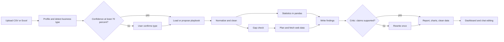

# Adaptive Market Research Agent

Drop in a messy CSV or Excel file and get back a clean dataset, charts, and a plain-language analysis where every claim says where it came from.

I built this to answer a question I kept running into as a data science student: what would a business analysis tool look like if it first worked out what kind of business it was looking at, and only then decided what to measure? The agent detects the business type, adapts its checklist, cleans the data, goes to the web only for the context your file is missing, and double-checks its own writing before it hands anything over.


## What it does

1. **Detects the business type** from the column profile (food delivery, retail, SaaS, or a new type it proposes) and shows a confidence score. Low confidence asks you to confirm.
2. **Loads a playbook** with the columns, questions and outside facts that matter for that type. You can edit it in the app, and edits are saved for next time.
3. **Normalizes the data**: canonical column names, text like "₹1,200" turned into numbers, dates parsed (day-first unless the data proves otherwise), spelling and case variants merged, duplicates removed. Every change is logged.
4. **Checks for gaps** between what the playbook expects and what your file has.
5. **Fetches external data only when useful**: it plans generic search queries, reads sources, extracts one value per metric, and tags it with its source, date and confidence. If it cannot find something, it says so instead of guessing.
6. **Computes all numbers with pandas**. The language model explains the numbers but never calculates them. Incomplete months are flagged so a half month is never reported as a drop.
7. **Checks its own work**: a critic step compares the draft with the evidence and triggers one rewrite if a claim is unsupported.
8. **Delivers** a report, a clean CSV, an external data table with source links, and a visible agent trace.
9. **Builds a dashboard you can edit by chat.** KPIs and charts are computed in code and themed for the domain: in the finance theme, profit is green and loss is red, with arrows and signs so color is never the only cue. Ask in plain language for a new chart, a KPI, a color change, a currency, or a shorter report. Every change can be undone, extra charts are suggested for you to tick, and the dashboard downloads as a standalone HTML file.

## How it works



## How agentic is it?

Honestly: it is a single orchestrated pipeline with specialized roles (normalizer, planner, analyst, writer, critic), not a swarm of independent agents. The agentic parts are the decisions the system makes on its own: which business type it is looking at, which gaps are worth fetching and whether they are publicly findable, whether a lookup succeeded, and whether its own draft survives a critique. Each role is a separate function, so moving to a graph framework such as LangGraph is a straightforward next step.

## Design decisions

- **Numbers come from code, words come from the model.** This removes most of the room for invented figures.
- **Your data wins over the web.** Web facts are labeled `[Web #id]`, your numbers are labeled `[Your data]`, and the two are never blended silently.
- **Privacy by design.** Only the column profile (names, types, three sample values), summary statistics and generic search queries reach the model. Full rows never do.
- **Free to run.** It uses Groq's free tier (email signup, no card). Gemini is optional. Results are cached on disk, so reruns cost no tokens.
- **Honest about gaps.** Missing data stays missing, with a reason.
- **The AI proposes, code disposes.** The chat returns edit requests in a fixed format. Code checks every request (real columns, numeric where needed, size limits) and runs it. No model-written code is ever executed.
- **Integrity rules built in.** Bars start at zero unless you ask otherwise, and then the chart says so. Filters and cut-off categories are printed on the chart. Incomplete months are excluded with a note. Personal-data columns (emails, phones, IDs) are refused. Green and red are reserved for gains and losses. The assistant is instructed to decline requests to hide complete unfavorable data or to flatter results, and to offer an honest alternative.

## Quick start

```bash
git clone https://github.com/Sujith-2027/adaptive-market-research-agent.git
cd adaptive-market-research-agent
python -m venv venv
venv\Scripts\activate          # macOS or Linux: source venv/bin/activate
pip install -r requirements.txt
copy .env.example .env         # macOS or Linux: cp .env.example .env
```

Add your free Groq key from console.groq.com to `.env`, then:

```bash
python sample_data.py                  # creates a deliberately messy test file
python -m streamlit run app.py
```

Upload `sample_orders.csv` in the sidebar and press **Run analysis**.

## Project structure

| File | Purpose |
|---|---|
| `app.py` | Streamlit interface |
| `pipeline.py` | All agent steps: detect, normalize, analyze, fetch, write, critique |
| `dashboard.py` | KPI and chart engine, themes, validation of chat edits, integrity checks, HTML export |
| `dash_ui.py` | Streamlit dashboard and chat view |
| `playbooks.py` | Per-industry playbooks, with proposals for unknown types |
| `llm.py` | Provider routing, disk cache, JSON retries |
| `tools.py` | Web search and page reader |
| `sample_data.py` | Generates a messy sample file for testing |

## Limitations

- Values in a column are assumed to share one currency and unit. There is no currency conversion yet.
- Excel files load the first sheet only.
- Web facts can come from a different region than your data, and the model's confidence score is self-reported. Verify sources before decisions.
- The "So what" lines are suggested actions, not findings.
- Free-tier rate limits can slow large runs. The agent retries and reports lookup failures.
- The dashboard supports bar, horizontal bar, line and histogram charts and a fixed set of KPI types. Chat requests outside that are declined.
- The downloaded dashboard loads its chart libraries from a CDN, so it needs an internet connection to draw charts.
- Chat edits to the written report are rewritten by the model and then checked, and the checker can miss things. Read the result, and use Undo if needed.
- There is no automated test suite yet. It has been tested on synthetic and real datasets by hand.

## Roadmap

- Move the pipeline to LangGraph nodes
- Follow-up questions in a chat box
- Region-aware web queries and source quality checks
- Currency detection and conversion
- Automated tests for the cleaning and statistics steps

## Built by

Sujith, BSc Data Science graduate from Mumbai. Feedback and ideas are welcome through GitHub issues.
